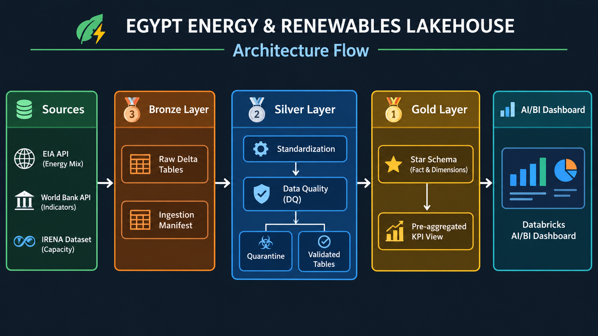
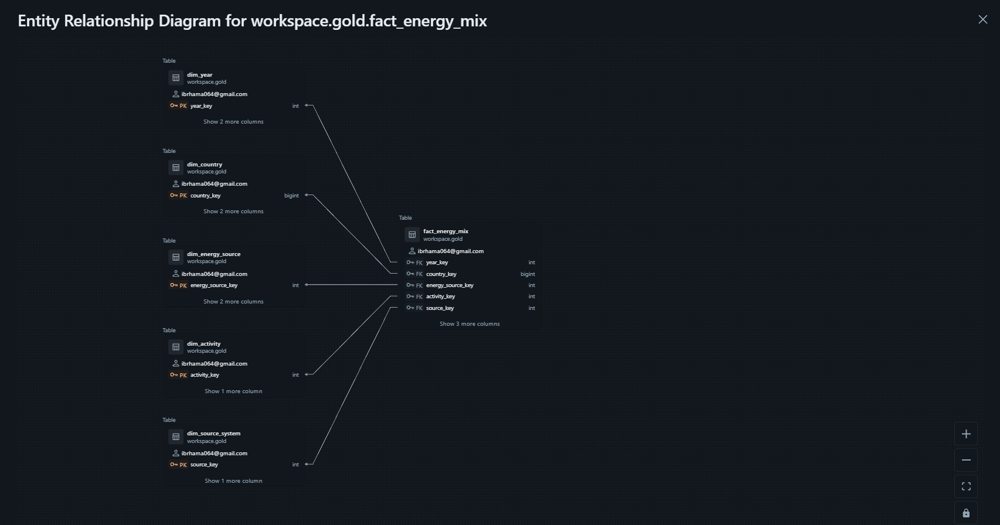
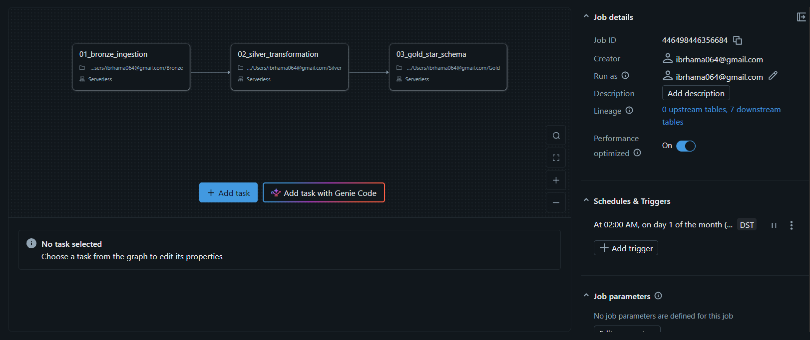
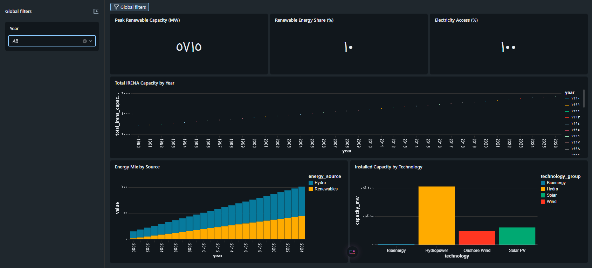

<div align="center">

# ⚡ Egypt Energy & Renewables Lakehouse

### End-to-End Unified Data Lakehouse on Databricks (Medallion Architecture) + Local Docker Compose Pipeline


</div>

---

## 📌 Project Overview

**Egypt Energy & Renewables Lakehouse** is a production-style Data Engineering pipeline built natively on **Databricks**, with a fully containerized **Docker Compose** setup for reproducible local execution and automated scheduling. It unifies fragmented energy, renewable capacity, and macroeconomic datasets from three authoritative global sources (**EIA API**, **World Bank API**, and **IRENA**) into a single governed **Medallion Architecture** (`Bronze` → `Silver` → `Gold`) managed by **Unity Catalog**, automated via **Databricks Workflows** (and **Ofelia** locally), and visualized through an executive **Databricks AI/BI Dashboard**.

---

## 🚀 End-to-End Pipeline at a Glance

| Stage | Layer / Component | Key Responsibility | Core Outputs |
| :--- | :--- | :--- | :--- |
| **01** | 🌐 **External Sources** | Ingest multi-source energy & macro data | EIA API, World Bank API, IRENA Dataset |
| **02** | 🥉 **Bronze Layer** | Immutable raw ingestion & operational tracking | `bronze_*` Delta Tables + `bronze_ingestion_manifest` |
| **03** | 🥈 **Silver Layer** | Schema standardization, deduplication & DQ quarantine | `clean_*` Tables + `dq_report_summary` + `quarantine_rows` |
| **04** | 🥇 **Gold Layer** | Kimball Star Schema & Unity Catalog PK/FK governance | 3 Fact Tables, 7 Dimension Tables, `vw_egypt_energy_annual_summary` |
| **05** | ⚙️ **Orchestration** | Automated sequential DAG & monthly scheduling | `Egypt_Energy_Lakehouse_Pipeline` (Databricks Workflows & Docker Compose) |
| **06** | 📊 **AI/BI Dashboard** | Zero-movement executive analytics over `workspace.gold` | Interactive KPIs, Energy Mix & Renewable Capacity Trends |

---

## 🏗️ Architecture Overview



---

## 🛠️ Tech Stack

| Category | Technology | Role in Project |
| :--- | :--- | :--- |
| **Lakehouse Platform** |  | Serverless Compute, Notebooks, Workflows & AI/BI |
| **Processing Engine** |  | Distributed ingestion, transformation & SQL modeling |
| **Storage Format** |  | ACID transactions, schema enforcement & local Parquet lake |
| **Governance** |  | Three-level namespace (`workspace.<layer>.<table>`) & PK/FK metadata |
| **Orchestration** |  | Sequential multi-task DAG, Cron scheduling & failure alerts |
| **Containerization** |  | Multi-container local pipeline execution & Cron scheduling |
| **Visualization** |  | Native Serverless SQL Warehouse executive dashboards |

---

## 🔍 Detailed Pipeline Stages

### 1. External Data Sources
* **EIA API:** Historical energy mix, production, and consumption metrics by energy source and activity.
* **World Bank API:** Macroeconomic and electricity access indicators for Egypt (`EGY`).
* **IRENA Dataset:** Installed renewable energy capacity (MW) segmented by technology (Solar PV, Onshore Wind, Hydropower, Bioenergy).

### 2. Bronze Layer (`notebooks/01_bronze_ingestion.ipynb`)
* Preserves raw source payloads in **Delta Lake** tables (`workspace.bronze.*`) without destructive modifications for full **auditability and replayability**.
* Logs ingestion metadata (source name, run timestamp, record count, load status) in **`bronze_ingestion_manifest`**.

### 3. Silver Layer (`notebooks/02_silver_transformation.ipynb`)
* Enforces consistent `snake_case` naming, strict type casting, unified country codes (`EGY`), and aligned reporting years.
* Removes duplicate records across natural business keys.
* Applies automated **Data Quality (DQ)** validation rules:
  * Records quality metrics in **`dq_report_summary`**.
  * Isolates invalid/null records into **`quarantine_rows`** instead of silently dropping data.
* Produces curated tables: `clean_energy_mix`, `clean_wb_indicators`, and `clean_irena_capacity`.

### 4. Gold Layer (`notebooks/03_gold_star_schema.ipynb`)
* Implements a **Kimball Star Schema** in `workspace.gold`:
  * **3 Fact Tables:** `fact_energy_mix`, `fact_wb_indicators`, `fact_irena_capacity`.
  * **7 Dimension Tables:** 3 Conformed (`dim_year`, `dim_country`, `dim_source_system`) + 4 Domain (`dim_energy_source`, `dim_activity`, `dim_indicator`, `dim_technology`).
* Registers **Primary Key / Foreign Key** metadata constraints in **Unity Catalog**.
* Exposes **`vw_egypt_energy_annual_summary`** as a pre-aggregated analytical view for executive KPIs.



### 5. Pipeline Orchestration (`workflows/job_config.json`)
* Automated end-to-end via **Databricks Workflows** (`Egypt_Energy_Lakehouse_Pipeline`).
* Strict sequential DAG dependencies: `01_bronze_ingestion` → `02_silver_transformation` → `03_gold_star_schema`.
* Scheduled on the **1st of every month at 02:00 AM (`Africa/Cairo`)** with failure email alerts and a 30-minute timeout safeguard.



### 6. Executive AI/BI Dashboard
* Built natively on **Databricks AI/BI Dashboards** directly over `workspace.gold` via **Serverless SQL Warehouse** (zero data movement).
* Features a **Global Year Filter**, IRENA renewable capacity growth (MW), EIA energy mix breakdown, and technology-level installed capacity comparison.



---

## 🐳 Local Execution & Scheduling with Docker Compose

In addition to the cloud Databricks deployment, the repository includes a **Docker Compose** setup (`docker-compose.yml`) that runs all three Medallion stages sequentially (`bronze` → `silver` → `gold`) over a shared local volume (`./data_lake`) and schedules automated monthly runs using **Ofelia**.

```bash
# Run the full Bronze -> Silver -> Gold pipeline locally and start the Cron scheduler
docker compose up
```

* **Sequential Execution:** `silver` waits for `bronze` to complete successfully, and `gold` waits for `silver`.
* **Shared Storage:** All containers communicate via the `lakehouse_net` bridge network and persist Parquet outputs to `./data_lake/{bronze,silver,gold}`.
* **Automated Scheduling:** The `scheduler` service triggers the full pipeline on the 1st of every month at 02:00 AM.

---

## 📁 Repository Structure

```text
egypt-energy-renewables-lakehouse/
├── notebooks/
│   ├── 01_bronze_ingestion.ipynb
│   ├── 02_silver_transformation.ipynb
│   └── 03_gold_star_schema.ipynb
├── workflows/
│   └── job_config.json
├── sql/
│   └── business_queries.sql
├── assets/
│   ├── architecture_flow.png
│   ├── star_schema_erd.png
│   ├── pipeline_orchestration.png
│   └── bi_dashboard.png
├── presentation/
├── docker-compose.yml
├── .gitignore
└── README.md
```

---

## 👥 Project Attribution & Evolution

* **Initial Foundation (Bronze & Silver Layers):** Originally initiated with my project teammates (**Marchelino** & **George**), who built the initial raw ingestion and Silver transformation stages.
* **End-to-End Completion & Enhancement (Current Version):** Completed, refactored, and extended by **Ahmed** to its current production-ready state—including the **Gold Star Schema**, **Unity Catalog PK/FK governance**, **Databricks Workflows orchestration & monthly scheduling**, **Executive AI/BI Dashboard**, and the **Docker Compose + Ofelia** containerized local pipeline.